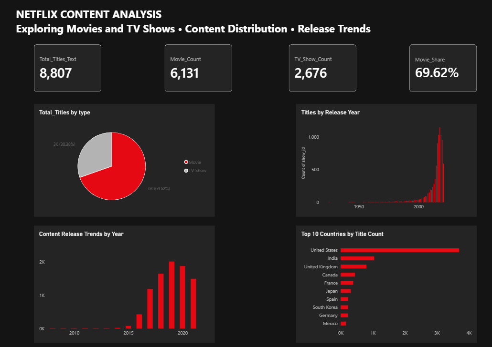

# Netflix Content Analysis | Power BI

## Project Overview

This project analyzes Netflix's movies and TV shows catalog using Microsoft Power BI. The goal is to explore content distribution, release trends, content additions over time, and the countries most represented in the catalog.

The project demonstrates data cleaning, transformation, data modeling, DAX measures, and interactive data visualization.

## Business Objectives

The analysis focuses on answering the following questions:

- What is the distribution of Movies and TV Shows in the Netflix catalog?
- What percentage of the catalog consists of Movies?
- How does content distribution vary by release year?
- How has the number of titles added to Netflix changed over time?
- Which countries are most represented in the Netflix catalog?

## Dataset

- **Source:** [Netflix Movies and TV Shows Dataset – Kaggle](https://www.kaggle.com/datasets/shivamb/netflix-shows)
- **Format:** CSV
- **Original records:** 8,807 titles
- **Key fields:** show_id, type, title, director, cast, country, date_added, release_year, rating, duration, listed_in, description.

The dataset contains information about movies and TV shows available in the Netflix catalog.

## Data Cleaning & Transformation

Data preparation was performed using Power Query in Power BI.

Key steps included:

- Imported the Netflix dataset from a CSV file.
- Promoted the first row to column headers.
- Corrected data types for relevant columns.
- Parsed CSV fields correctly to preserve text containing quotation marks and delimiters.
- Created a referenced country query to analyze titles associated with multiple countries.
- Split the country column by comma into separate rows.
- Trimmed extra spaces from country names.
- Excluded blank country values from the country analysis.

## Data Analysis & DAX

Created DAX measures to calculate key metrics, including:

- Total Titles
- Movie Count
- TV Show Count
- Movie Share
- Country Titles

Used DISTINCTCOUNT to avoid counting the same title more than once in the country analysis.

## Dashboard

The Power BI dashboard includes:

- **KPI Cards:** Total Titles, Movie Count, TV Show Count, and Movie Share.
- **Pie Chart:** Movie vs. TV Show distribution.
- **Column Chart:** Number of titles by release year.
- **Column Chart:** Number of titles added to Netflix by year.
- **Bar Chart:** Top 10 countries by title count.

## Key Business Insights

1. **Content Distribution:** Movies account for approximately 69.62% of the catalog (6,131 titles), while TV Shows account for approximately 30.38% (2,676 titles). This indicates that Movies make up the larger share of the dataset.

2. **Release Year Trend:** 2018 is the most represented release year in the catalog, with 1,147 titles. This reflects the release-year distribution of titles in the dataset, not necessarily Netflix's original production output.

3. **Country Representation:** The United States is the most represented country in the dataset. Since a title can be associated with multiple countries, country-level counts may overlap and should not be summed to calculate the total number of unique titles.

4. **Further Analysis Opportunity:** The difference between Movie and TV Show counts provides an opportunity for further portfolio analysis. Additional audience engagement and viewing data would be needed before making content investment recommendations.

## Tools & Technologies

- Microsoft Power BI Desktop
- Power Query
- DAX
- Data Cleaning & Transformation
- Data Visualization
- Exploratory Data Analysis (EDA)

## Project Files

- `Netflix_Content_Analysis.pbix` – Power BI project file.
- `images/netflix_dashboard.png` – Dashboard screenshot.

## How to View the Project

1. Download the `.pbix` file from this repository.
2. Open it using Microsoft Power BI Desktop.
3. Explore the dashboard and visualizations.

## Author

[Thuan Minh Nhan](https://github.com/thuanminhnhan)
